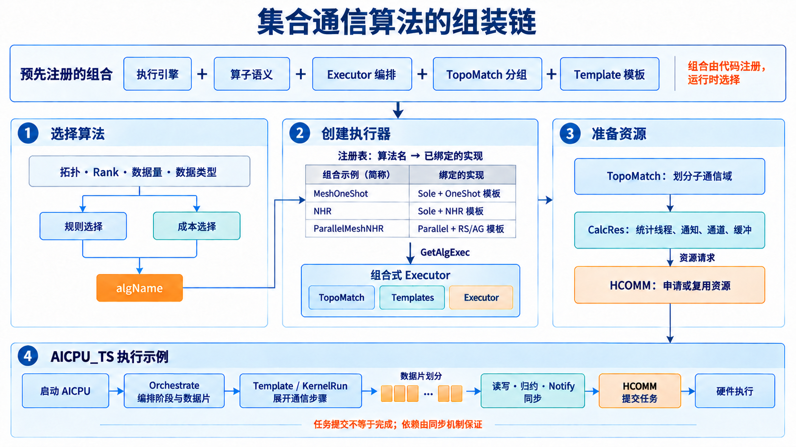
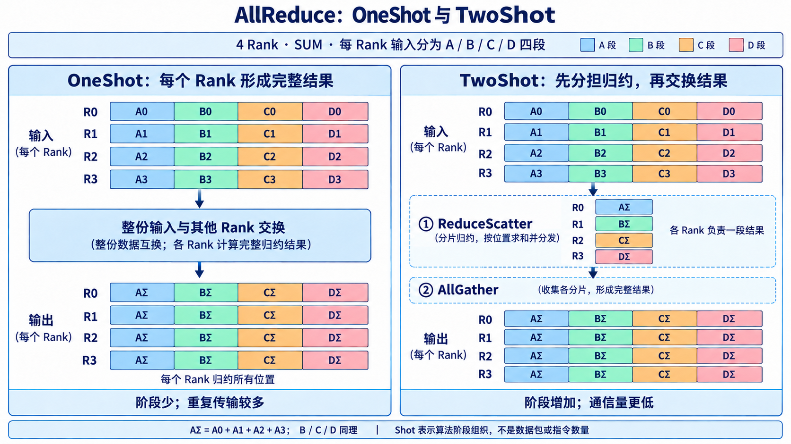
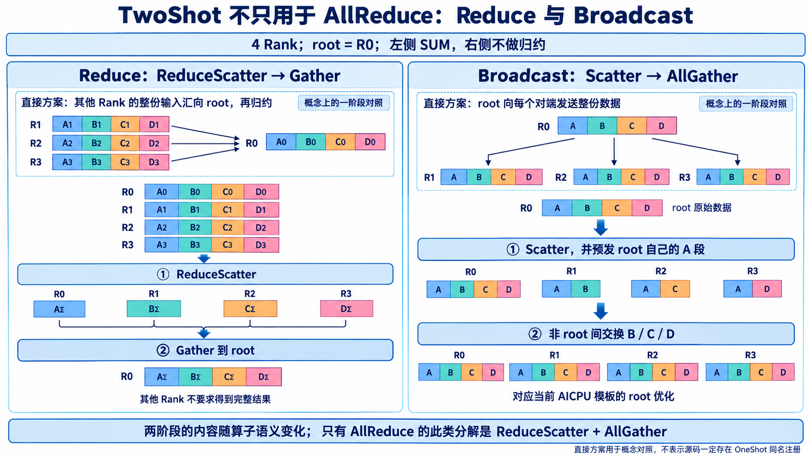
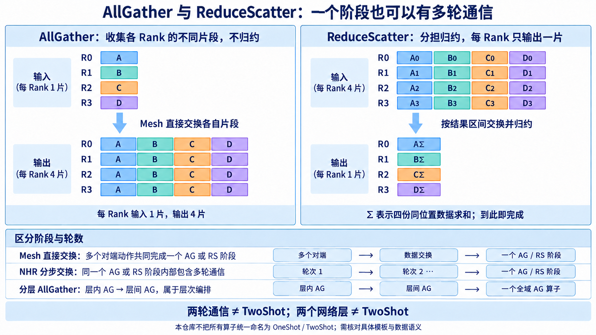
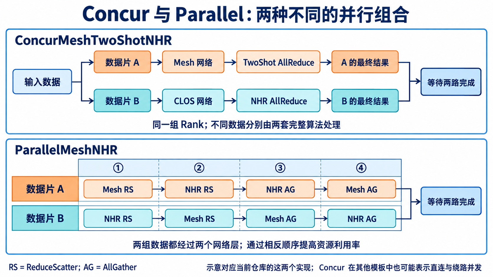
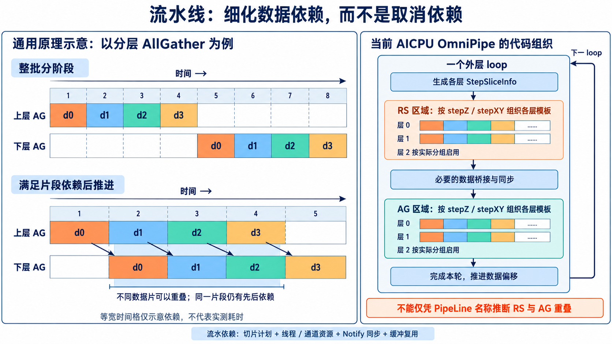

# 集合通信算法如何组装：从 OneShot、TwoShot 到 Executor、Template 与 HCOMM

本文解释一件事：一次 `AllReduce` 调用，如何变成“选定一个算法组合、准备对应资源、展开有依赖关系的通信任务”。以当前仓库的 Ascend 950 / V2 算法框架为主，沿用真实注册名，重点展开 AICPU_TS 路径，并说明 AIV、CCU 和其他算子的差异。

**先抓住三层关系：算子定义结果，算法模板定义通信步骤，执行器把模板按数据片、网络层和依赖关系组织起来。** OneShot / TwoShot 描述阶段组织；Mesh / NHR 描述通信结构或算法族；Sole / Sequence / Parallel / Concur / PipeLine 描述组合方式。它们不是一组互斥的选项。

**OneShot / TwoShot 不是 AllReduce 专属概念，也不是所有算子必须具备的一对选项。** 当前源码对 AllReduce 明确提供两类命名，对 Reduce、Broadcast 也明确提供 TwoShot；但两阶段做什么，要由算子语义决定。AllGather、ReduceScatter 的直接 Mesh 实现可以按单阶段理解，不能因此给它们虚构一个带 `OneShot` 的注册名。[第 3.5—3.8 节](#other-shots)专门用数据图比较这些情况。

核对日期：2026-10-15。源码依据固定为本仓库提交 `9aae2b3abdbaf03f12e47fe8617d9391ce067184`，上游版本见 [sources.lock.json](../sources.lock.json)。本文属于静态源码导读；示意图不是上板 trace，时间格宽度不代表实测耗时，也不用于断言未公开的下一代产品行为。

## 阅读路线

- [1. 一次通信涉及的七类概念](#concepts)：先把容易混在一起的术语分层。
- [2. 一条算法是怎样组装出来的](#assembly)：从注册宏追到运行时执行。
- [3. OneShot、TwoShot 与 NHR](#shots)：AllReduce、Reduce、Broadcast、AllGather、ReduceScatter 的阶段与数据流。
- [4. 五类主要编排](#orchestration)：Sole、Sequence、Parallel、Concur、流水线。
- [5. Template 内部又组装了什么](#template)：数据片、通道、线程、通知与搬运。
- [6. 真实算法名的拆解与注册配方](#recipes)：把术语对应到代码。
- [7. 从 Host 到 AICPU / HCOMM 的完整实例](#walkthrough)：首次执行与缓存复用。
- [8. 更换算子或执行引擎时，哪些部分会变化](#variants)。
- [9. 拓扑、性能与下一代全 CLOS 的理解方式](#performance)。
- [10. 易错点与源码阅读顺序](#reading)。
- [源码索引](#sources)：固定提交、具体文件、函数入口与行号。

<a id="concepts"></a>
## 1. 一次通信涉及的七类概念

| 层次 | 例子 | 回答的问题 | 不应混淆为 |
|---|---|---|---|
| 算子语义 | AllReduce、AllGather、ReduceScatter | 每个 Rank 最终应该得到什么？ | 网络拓扑、某一条搬运指令 |
| 执行引擎 / 展开模式 | AICPU_TS、AIV、CCU_MS、CCU_SCHED | 谁展开或执行算法，任务如何交给设备？ | OneShot / TwoShot |
| 物理拓扑与逻辑分组 | Mesh、CLOS、层内 / 层间子通信域 | 哪些 Rank 通过什么资源互通？ | 模板数量或通信轮数 |
| 算法族与阶段组织 | Mesh OneShot、Mesh TwoShot、NHR、Ring | 怎样分工、选择通信对象并得到结果？ | 执行器的全部职责 |
| Executor 编排 | Sole、Sequence、Parallel、Concur、PipeLine | 哪些模板处理哪些数据，先后或重叠关系是什么？ | 独立于模板的一次真实网络传输 |
| Template 模板 | Mesh ReduceScatter、NHR AllGather 等具体类 | 在给定子通信域内，怎样把一个阶段展开？ | 一个数据块、一条 SQE、一个硬件单元 |
| 通信资源与动作 | Channel、Thread、Notify、Read / Write / Reduce | 用哪条通道、在哪个执行序列提交什么动作？ | 选择全局集合通信算法的逻辑 |

**Rank** 是通信域内的参与者编号。本文示例把它画成一个独立参与者，不把 Rank 数机械地等同于服务器数、芯片数或物理端口数。

**Mesh 与 CLOS**：前者在本文算法语境中强调所需的直接全连接关系；后者指通过交换网络互联。CLOS 中的 Rank 仍可互通，区别在于链路实现、带宽共享、层次和拥塞特征。`MESH_1D_CLOS` 表示代码识别出的混合拓扑形态。

**物理层与算法层**：物理层来自 RankGraph / 拓扑信息；算法层是本次算法所需的分组。`TopoMatch` 把两者关联起来。一个物理层可能服务不同逻辑分组，多个物理层也可能被一个算法视图覆盖。因此，`TopoMatchOneLevel` 不表示“机器里只有一级交换机”，`TwoLevel` 也不表示 TwoShot。[S06]、[S07]

**算法名是组合的标识。** 例如 `AicpuAllReduceConcurMeshTwoShotNHR` 同时包含执行引擎、算子、并发编排和两个算法模板的信息；不能把名称中的任意一个词单独当作整个实现。

<a id="assembly"></a>
## 2. 一条算法是怎样组装出来的



图 1：上方是预先绑定的组成项，下方是运行时过程。规则选择与成本选择是替代入口；图中以普通内置算法、资源未命中的 AICPU_TS 路径说明执行，未展开插件接管与缓存快路径。注册表中的短名称只作阅读标签，完整名称见第 6 节。

### 2.1 第一层组装：源码预先绑定“执行器 + 拓扑匹配器 + 模板”

以真实注册为例：[S03]

```cpp
REGISTER_EXEC_V2(
    HcclCMDType::HCCL_CMD_ALLREDUCE,
    AicpuAllReduceSoleMeshOneShot,
    InsV2AllReduceSoleExecutor,
    TopoMatchOneLevel,
    InsTempAllReduceMesh1DOneShot);
```

这段注册的含义是：

| 注册项 | 本例内容 | 作用 |
|---|---|---|
| 算子键 | `HCCL_CMD_ALLREDUCE` | 明确结果语义 |
| 算法名 | `AicpuAllReduceSoleMeshOneShot` | 选择器与工厂之间的查找键 |
| Executor | `InsV2AllReduceSoleExecutor` | 管理资源、循环块与模板调用 |
| TopoMatch | `TopoMatchOneLevel` | 为模板建立一个覆盖相应 Rank 的算法层 |
| Template | `InsTempAllReduceMesh1DOneShot` | 具体实现 Mesh OneShot AllReduce |

宏最终把类似下面的 C++ 类型交给工厂创建函数：

```cpp
InsV2AllReduceSoleExecutor<
    TopoMatchOneLevel,
    InsTempAllReduceMesh1DOneShot>
```

这里有两个“模板”：`<...>` 是 **C++ 泛型机制**；`InsTempAllReduceMesh1DOneShot` 是 **集合通信算法模板类**。前者负责复用代码结构，后者包含通信逻辑。

类型组合由代码和编译条件确定；注册代码在初始化时把创建函数存入注册表。运行时拿到算法名以后查表创建对象，**不是把字符串拆成若干单词，再任意拼接一个新算法**。[S01]、[S02]

多模板组合分别使用 `REGISTER_EXECUTOR_BY_TWO_TEMPS`、`REGISTER_EXECUTOR_BY_FOUR_TEMPS` 或可变数量的 `REGISTER_EXEC_V2_MULTI`。模板参数顺序由具体执行器定义，不能仅按宏中排列顺序推断真实运行顺序。

### 2.2 第二层组装：选择一个当前可用的组合

`Selector` 收集拓扑、算子参数和执行配置，然后进入对应选择入口：[S04]

```text
算子参数 + 拓扑信息 + 展开配置
  ├─ 规则路径：ExecuteSelector → 各算子 AutoSelector
  └─ 新选择器：SelectorEngine → 候选过滤 / 成本表 / 可选 tuner → 最小有效成本
                                    ↓
                            完整算法名 algName
```

两条路径由配置开关及算子支持情况决定，不应画成“规则选完，必定再经过成本模型”。规则中的消息阈值也不是所有选择路径共同的定律。

选择时关注的输入包括：有效网络层、Mesh / CLOS 形态、Rank 规模和分组对称性、数据量、数据类型、归约操作、确定性要求、输入输出是否重叠、内存访问能力以及执行引擎。`REGISTER_ALG_ATTRS` 为注册组合补充能力和约束；成本路径还会探测匹配、资源或成本信息。具体筛选顺序以各入口为准。[S03]、[S05]

这里的“选择”和后面的“组装执行资源”不是同一件事：选出一个名字，不代表通道已建好，也不代表通信已经开始。

### 2.3 第三层组装：建立分组并申请资源

内置 V2 路径由 `CollAlgExecRegistryV2::GetAlgExec` 按“算子类型 + 算法名”找到创建函数。随后 `HcclGetAlgRes` 先尝试复用资源；未命中时，依次执行：[S02]、[S08]

1. **`CalcAlgHierarchyInfoV2` / `TopoMatch`**：确定每个算法层、每个子通信域包含哪些 Rank，以及使用哪些物理层。
2. **Executor 的 `CalcRes`**：组合各 Template 的资源需求，再加入模板之间的同步资源。
3. **Template 的 `CalcRes`**：根据具体算法计算需要联系哪些对端、需要多少线程和通知等。
4. **HCOMM 资源接口**：申请或复用 Thread、Channel、缓冲和相关上下文；Channel 申请路径负责实际通信资源建立与必要信息交换。
5. **保存执行上下文**：将已取得的资源及分组信息组织成执行阶段可用的描述。

`CalcRes` 主要是在计算和汇总请求，不能直接等同于“网络已经建链成功”。`TopoMatch` 也不会负责发送算子数据。

### 2.4 第四层组装：把模板展开成带依赖的任务

AICPU_TS 路径把运行参数和资源上下文交给设备侧；AICPU 内的 `OpOrchestrate` 根据算法名取得执行器，再调用 `Orchestrate`。[S09]

```text
Executor::Orchestrate
  → 决定数据分片、循环次数、模板顺序、线程分配与同步
  → Template::KernelRun
  → 构造对端、地址、长度、归约类型和通知动作
  → 通信封装 / HCOMM
  → 任务提交、依赖满足、硬件搬运或支持的归约
```

因此，“算法组装”有静态和动态两部分：**静态绑定实现种类；动态填入 Rank、数据区间、资源句柄与依赖。** Host 资源阶段和 AICPU 执行阶段可能各自按名字创建执行器，不能理解为一个 Host C++ 对象直接跨处理器继续运行。

<a id="shots"></a>
## 3. OneShot、TwoShot 与 NHR：先看数据如何得到结果



图 2：以 4 Rank 的 SUM AllReduce 为例。A、B、C、D 表示张量中的不同位置区间，数字表示输入来自哪个 Rank；`AΣ` 是四个 Rank 的 A 段相加后的结果。图中不指定由 CPU、搬运引擎还是其他硬件执行归约。

### 3.1 OneShot：每个 Rank 形成整份归约结果

当前 Mesh OneShot 的核心做法是让每个 Rank 获取其他 Rank 的整份输入，并在本 Rank 形成完整结果。例如 R0 要得到 AΣ、BΣ、CΣ、DΣ，就要取得 R1、R2、R3 对应各段的数据；其他 Rank 做同类工作。[S10]

普通非对称内存路径会将数据写入对端 CCL 缓冲，再做本地归约；支持对称内存的路径可以通过 ReadReduce 访问对端输入。**通信算法的 OneShot 语义不变，底层读写与归约落点可以变化。**

OneShot 减少阶段切换，通常有利于小消息；代价是整份输入面向多个对端重复传输，各 Rank 也重复承担完整结果的归约。它不是“一次 API 调用”“一个包”“一条 SQE”或“一次物理跳转”。内部仍有多个对端动作、通知、拷贝及可能的分块循环。

### 3.2 TwoShot：分担结果，再交换结果

当前 Mesh TwoShot 在模板中依次调用 `RunReduceScatter`、`RunAllGather`。[S11]

| 阶段 | R0 得到什么 | R1 得到什么 | R2 得到什么 | R3 得到什么 |
|---|---|---|---|---|
| 初始 | A0 / B0 / C0 / D0 | A1 / B1 / C1 / D1 | A2 / B2 / C2 / D2 | A3 / B3 / C3 / D3 |
| ReduceScatter 后 | AΣ | BΣ | CΣ | DΣ |
| AllGather 后 | AΣ / BΣ / CΣ / DΣ | AΣ / BΣ / CΣ / DΣ | AΣ / BΣ / CΣ / DΣ | AΣ / BΣ / CΣ / DΣ |

第一阶段按结果区间分工，避免每个 Rank 都归约全部区间；第二阶段只交换已经归约好的片段。两阶段之间存在依赖：尚未完成归约的片段不能作为最终结果分发。

`ChunkTwoShot` 仍属于这个思路，进一步调整数据分块与执行方式；Chunk 并不构成第三个集合通信阶段。需要区分 Executor 为适配缓冲容量划分的外层 loop，与模板内部的分片、轮次和传输拆分。[S03]

### 3.3 NHR：两阶段内部采用不同的通信关系

NHR 全称为 **Nonuniform Hierarchical Ring，非均衡层次环**。它是一种组织对端关系和数据片交换的算法；不是物理环形布线，也不是执行引擎。[S12]、[S13]

在当前 AllReduce 模板中：

```text
NHR AllReduce
  ├─ NHR ReduceScatter：按步骤交换并归约数据片
  └─ NHR AllGather：按步骤传播已经归约好的片段
```

每个阶段的理论轮数是 `ceil(log2 P)` 量级，不能把 NHR AllReduce 画成“只有两次网络收发”。对 2 次幂 Rank 的标准示例，ReduceScatter 逐轮缩小交换量，AllGather 反向扩大；非 2 次幂时需按实际分片和步骤表处理。

当前 NHR 代码先生成 `reduceScatterSteps_`、`allGatherSteps_`，再逐通道执行 RS 和 AG；支持多通道时还会把数据分给多个 Channel。其 `RunReduceScatter` 与 `RunAllGather` 是明确的两个阶段。[S12]

因此，应同时记住两件事：

- 按阶段分解，Mesh TwoShot 和 NHR AllReduce 都采用 RS + AG。
- 按具体实现，它们是不同模板，不能因为同为两阶段，就把 NHR 写成 `MeshTwoShot`。

### 3.4 通信量为什么不同

设每 Rank 的 AllReduce 输入为 `M` 字节，参与数为 `P`。按每 Rank 单方向发送的有效载荷计算，忽略通知、协议头、对齐和额外拷贝：

| 算法模型 | 每 Rank 发送量 | 趋势 |
|---|---|---|
| 本文的整份输入互换 OneShot | `(P−1)M` | Rank 增多，重复发送量快速增大 |
| 均匀分片 Mesh TwoShot | `2(P−1)M/P` | 通过分担归约降低流量 |
| 标准 NHR 两阶段模型 | 约 `2(P−1)M/P` | 进一步改变轮次和对端组织 |

8 Rank 时分别为 `7M` 与 `1.75M`。这是有效载荷差异，不是耗时必然相差 4 倍：直连并行能力、端口带宽、拥塞、归约与启动开销都会改变实际时间。非均匀分片或实现优化也可能改变单个 Rank 的细节。

<a id="other-shots"></a>
### 3.5 OneShot / TwoShot 是否只针对 AllReduce？

**不是。TwoShot 表示所讨论实现的两阶段组织，不固定等于 ReduceScatter + AllGather。** 后一个分解对应 AllReduce 的结果要求；把它搬到其他算子会改变结果语义。仓库所带的 Mesh 算法说明也分别列出了 Broadcast、Reduce、AllReduce 的两阶段分解。[S28]

下面区分“源码确实使用的名称”和“为了理解而做的阶段归纳”，范围是本次核对的 V2 算法实现：

| 算子 | 直接完成的概念方案 | 当前明确的两阶段实现 | 源码命名与阅读边界 |
|---|---|---|---|
| AllReduce | 每个 Rank 获取其余输入，形成完整归约结果 | ReduceScatter → AllGather | 明确有 `SoleMeshOneShot`、`SoleMeshTwoShot`；NHR 也可按 RS + AG 分解，但模板名称不同 |
| Reduce | 其他 Rank 的输入汇到 root，由 root 形成完整归约结果 | ReduceScatter → Gather 到 root | 明确有 `AicpuReduceSoleMeshTwoShot`；直接实现叫 `AicpuReduceSoleMesh`，不应改称源码中的 `OneShot` |
| Broadcast | root 将整份数据发送给其他 Rank | Scatter → AllGather；当前 AICPU 有 root 片段预发送优化 | 明确有 `AicpuBroadcastSoleMeshTwoShot`；直接广播在此作为概念对照 |
| AllGather | 每个 Rank 向其他 Rank 提供自己的输入片段 | 不需要附加第二个集合通信阶段才能满足结果语义 | 当前 Mesh / NHR 模板以 `AllGather` 命名；多轮交换、两层 AG 都不能单凭数量叫 TwoShot |
| ReduceScatter | 每个 Rank 收集并归约自己负责的结果区间 | 输出本 Rank 的一片后即可结束 | 当前 Mesh 模板以 `ReduceScatter` 命名；补上全域 AG 会形成 AllReduce 的结果 |
| Scatter / 内部 Gather | root 分发不同片段 / 各 Rank 将片段汇到 root | 可按网络层次进一步组织 | 分层不自动构成一个源码名为 TwoShot 的模板；这里的 Gather 是内部阶段，不意味着当前公开接口提供独立 Gather 算子 |
| AlltoAll / AlltoAllV / AlltoAllVC | 每对 Rank 交换属于对方的数据 | 可采用 Pairwise、分组或分层交换 | 不应套入 RS + AG；收发轮数、网络层数与 Shot 命名不是同一个维度 |

判断依据是**注册绑定 + 模板阶段 + 最终数据归属**，不是仅搜索到一处 “one shot” 注释就给整个算子定性。注册存在也不表示每种引擎、拓扑和数据规模都会选中它。[S29]、[S31]、[S27]、[S35]

### 3.6 Reduce 的 TwoShot：分担归约，再把结果交给 root



图 3：两种真实 TwoShot 的数据流。上方小图给出直接方案作为概念对照，不能视为源码注册名。Reduce 直接方案中 root 框内的 A0—D0 是 root 自己的输入，还需与箭头所示远端输入归约；下方 TwoShot 才逐项画出最终结果。Broadcast 无数值归约，右侧不使用 Σ。

设 4 Rank、root = R0，每个 Rank 的 Reduce 输入仍是 A、B、C、D 四段。目标只要求 **R0 得到 AΣ、BΣ、CΣ、DΣ**。

1. **ReduceScatter**：R0 负责归约所有 A，R1 负责所有 B，R2 负责所有 C，R3 负责所有 D。中间结果分别是 AΣ、BΣ、CΣ、DΣ。
2. **Gather 到 root**：R1、R2、R3 把自己的已归约片段交给 R0；R0 拼接自己的 AΣ 和收到的 BΣ、CΣ、DΣ。

这里第二阶段是 **Gather**，不是 AllGather：其他 Rank 无须收到完整结果。它们可能仍保留临时片段或原始输入，不能把“无须完整输出”解释为“缓冲被清空”。

代码关系很直接：[S29]、[S30]

```text
AicpuReduceSoleMeshTwoShot
  → ReduceSoleExecutor + TopoMatchOneLevel + ReduceMesh1DTwoShot
  → KernelRun
      ├─ RunReduceScatter
      └─ RunGatherToRoot
           ├─ root：GatherLocalData + GatherRemoteData
           └─ 其他 Rank：SendToRoot
```

对照用的 `AicpuReduceSoleMesh` 在 `ReduceMesh1D::RunReduce` 中区分 root 与其他 Rank：root 收集并归约，其他 Rank 发送数据。两阶段方案把归约工作按结果区间分给更多参与者；是否更快，还取决于阶段开销、root 链路与归约能力。**不要把“少一个集中归约瓶颈”写成所有场景都更快。** [S29]、[S34]

### 3.7 Broadcast 的 TwoShot：分发片段，再补齐全部数据

Broadcast 的输入只有 root 的整份数据有意义。4 Rank、root = R0，输入是 A / B / C / D，目标是每个 Rank 都获得这四段；整个过程**不求和，也不做其他数值归约**。

一般分解是：先由 root 以 Scatter 将不同片段分给不同 Rank，再由 AllGather 互通片段。当前 `InsTempBroadcastMesh1DTwoShot` 进一步优化了 root 的角色：[S31]、[S32]、[S33]

| 位置 | R0（root） | R1 | R2 | R3 |
|---|---|---|---|---|
| 初始有效数据 | A / B / C / D | — | — | — |
| Scatter 及 root 片段预发送后 | A / B / C / D | A / B | A / C | A / D |
| 非 root 间 AllGather 后 | A / B / C / D | A / B / C / D | A / B / C / D | A / B / C / D |

第一阶段，`RootSendData` 给每个对端发送**对端负责的片段**，同时发送 **root 自己负责的 A 段**。因此第二阶段只需 R1、R2、R3 交换 B、C、D：root 已持有全部数据，其他 Rank 也已拥有 A，root 不必再参与这段 AllGather。

```text
AicpuBroadcastSoleMeshTwoShot
  → InsV2BroadcastSoleExecutor + TopoMatchOneLevel
  → InsTempBroadcastMesh1DTwoShot::KernelRun
      ├─ RunScatter：root 发送目标片段，并预发 root 片段
      └─ 仅非 root 执行 RunAllGather：通信集合排除 self 与 root
```

**TwoShot 描述整个算法的阶段结构，不要求每个 Rank 都执行两个相同阶段。** 这也是为什么只画“所有 Rank 做 Scatter，再所有 Rank 做 AllGather”虽然表达了通用分解，却没有完全反映本模板的实际优化。

对照直接广播：root 向其他 Rank 重复发送完整输入；两阶段方案让非 root 也承担片段传播。此处只说明数据分工变化，不把 AllReduce 的 `(P−1)M` 与 `2(P−1)M/P` 流量公式直接用于 Broadcast——参与者角色及流量分布已不同。

### 3.8 AllGather / ReduceScatter：单阶段不等于一次收发



图 4：左侧 AllGather 拼接输入，不求和；右侧 ReduceScatter 按位置归约，每个 Rank 只输出自己的结果区间。底部说明通信轮数与集合通信阶段的区别，不表示所有模板采用相同的步骤数。

**AllGather 示例。** R0 输入 A、R1 输入 B、R2 输入 C、R3 输入 D。直接 Mesh 方案让每个 Rank 取得其他 Rank 的片段，输出都是 A / B / C / D。当前 `InsTempAllGatherMesh1D::KernelRun` 先处理本地数据，再调用 `RunAllGatherMesh`，并按需要在主从线程之间同步。内部有多个对端动作，本地拷贝也可能单独发生；这里的“一个阶段”只是在集合通信语义层面描述 AllGather。[S36]

**ReduceScatter 示例。** 每 Rank 都输入 A_i / B_i / C_i / D_i；R0 只需 AΣ、R1 只需 BΣ、R2 只需 CΣ、R3 只需 DΣ。当前 `InsTempReduceScatterMesh1D::KernelRun` 调用 `RunReduceScatter`，再按内存模式处理输出搬运或后处理。数据类型、归约方式可能改变归约后端，但最终仍只输出各自的一片，不能把这些辅助步骤数成第二个集合通信阶段。[S37]

使用 NHR 时，同一个 AllGather 或 ReduceScatter 阶段内部可以有多轮对端交换；分层时，也可以用多个子通信域模板完成一个全域算子。这些都与“Mesh AllReduce TwoShot = RS + AG”处在不同的描述层次：

| 看到的现象 | 应怎样描述 | 为什么不直接叫 TwoShot |
|---|---|---|
| 一个 AG 内部有两轮交换 | 两轮通信完成一个 AllGather 阶段 | 轮次是阶段内部的步骤 |
| 层 0 AG → 层 1 AG | 分层 AllGather，按层组合模板 | 网络层和数据覆盖范围改变，不是所有实现都采用 Shot 命名 |
| 一个 RS 分三次 loop 处理输入 | 分块完成同一个 ReduceScatter | loop 解决容量或粒度约束，没有增加结果语义 |
| RS → AG，且最终每 Rank 得到全部归约结果 | AllReduce 的两阶段分解 | 此时输入输出语义确实构成 AllReduce |

因此，若问“其他算子的 OneShot / TwoShot 是什么”，准确做法不是给所有算子强行列两款算法，而是先找**是否存在这个命名**，再说明**每个阶段完成什么、输出留在哪里**。跨库、跨平台的 Shot 命名也未必一致。

### 3.9 Ring、RHD、NB、AHC 又放在哪一层

这些名称主要补充“阶段内部怎样通信”或“怎样组织层次”，与 Sole / Sequence 等执行器名称不是同一套枚举。仓库所带算法指南给出了如下概念；其产品支持范围应继续查对应平台说明，不能把通用介绍视为当前 V2 的全量支持矩阵。[S35]

| 算法族 | 核心组织方式 | 与本文组装逻辑的关系 |
|---|---|---|
| Ring / Double-Ring | 沿逻辑环传递片段，或利用两条环 | 可以承担某个 RS / AG 等阶段；逻辑环不要求物理设备按环布线 |
| RHD | Recursive Halving-Doubling，递归二分 / 倍增 | 按阶段递归调整交换区间；非 2 次幂规模需要额外处理 |
| NHR | Nonuniform Hierarchical Ring，非均衡层次环 | 生成分步交换关系，可作为单层模板或多层组合中的一层 |
| NB | Nonuniform Bruck，非均匀 Bruck 算法 | 另一种对数步数的通信组织，不能与 NHR 仅因步数相近而混称 |
| Pairwise | 按轮次安排成对交换 | 面向 AlltoAll 系列的数据目的地关系，不含数值归约语义 |
| AHC | Asymmetric Hierarchical Concatenate，非对称层次化组合 | 面向多层及非对称 Rank 分布；属于更高层次的组织思路 |

算法族、阶段、网络层、编排和引擎可以交叉组合；能否使用某个组合，最终仍以注册、选择器及实现为准。

<a id="orchestration"></a>
## 4. 五类主要编排：究竟怎样组合模板

下面五类是理解当前执行器的主要框架，不是全仓所有后缀的穷举。严格归约顺序、双 Die、DPU 协同等专门变体在第 6、8 节补充。

| 编排 | 组织单位 | 核心依赖 | 并行机会来自哪里 |
|---|---|---|---|
| Sole | 一个主要算法视图 / 模板执行路线 | 模板内部定义 | 模板内部多个对端、线程或通道 |
| Sequence | 依次串接不同层的阶段模板 | 当前阶段的结果供下一阶段使用 | 每个阶段内部仍可并行 |
| Parallel | 多份数据走互补的多层处理顺序 | 每份数据自身的阶段顺序；阶段间同步 | 同一步利用不同网络层 |
| Concur | 并行算法路径或模板内部并发路径 | 路径内有序，适当位置汇合 | 不同网络、直连与绕路等资源 |
| PipeLine / OmniPipe | 更细的数据片与分层步骤 | 片段级数据依赖、缓冲复用和通知 | 不同片段或维度的工作重叠 |

### 4.1 Sole：一个主要算法路线，不代表“单线程、单通道、单阶段”

`InsV2AllReduceSoleExecutor` 根据分组和资源创建一个主要 Template，按照单次可处理的数据量计算 loop，逐块调用 `KernelRun`。[S14]

```text
全部数据
  → 按缓冲 / 传输约束分成 loop 0、loop 1、…
  → 每个 loop 调用同一个主要模板
  → 模板内部组织对端、通信阶段和同步
```

所以 `SoleMeshOneShot` 与 `SoleMeshTwoShot` 都合理；`SoleNHRMultiLink` 也合理。Sole 位于执行器组合层，MultiLink 位于资源使用层，二者没有冲突。

名称也不是严格语法：`SoleMeshConcur` 注册到专门的 TwoShotSole 执行器，并绑定 RS、AG 两个绕路模板。不能制定“Sole 后面一定恰好一个 C++ 模板参数”的规则。[S18]

### 4.2 Sequence：沿网络层次依次完成阶段

两层 AllReduce 的典型序列是：

```text
层 0 ReduceScatter
  → 层 1 ReduceScatter
  → 层 1 AllGather
  → 层 0 AllGather
```

中间两步合起来相当于在层 1 做 AllReduce，因此也常被概括为“层内 RS → 层间 AR → 层内 AG”。前面的层内 RS 先缩小每个参与者需要带到上层处理的数据区间，后面的 AG 再逐层恢复完整结果。

当前 `AicpuAllReduceSequenceMeshConcurNHR` 实际绑定四个模板：带绕路并发的 Mesh RS、NHR RS、NHR AG、带绕路并发的 Mesh AG。**外层是 Sequence，内层仍可有 Concur。** 外层分阶段有序，不代表阶段内所有对端逐个串行。[S15]

三层变体继续展开层次，但不能仅靠名字中的 NHR 出现次数推算所有通信轮数，还要检查各层 Rank 数、退化层与模板实现。

### 4.3 Parallel：两份数据采用相反的层次顺序



图 5：上半部分对应 `ConcurMeshTwoShotNHR`，下半部分对应 `ParallelMeshNHR`。颜色区分数据区间；RS / AG 分别为 ReduceScatter / AllGather。阶段格仅展示依赖，不表示等长耗时。

`ParallelMeshNHR` 把输入划成 A、B 两部分，两部分都需要经过两个通信层：[S16]

| 阶段 | 数据 A | 数据 B | 目的 |
|---|---|---|---|
| 1 | Mesh RS | NHR RS | 同时利用两个通信层 |
| 2 | NHR RS | Mesh RS | 两份数据交换所用层，完成剩余归约 |
| 3 | NHR AG | Mesh AG | 开始传播归约结果 |
| 4 | Mesh AG | NHR AG | 恢复各自的完整输出区间 |

执行器不是简单创建两个相同 AllReduce。它为各阶段计算不同的区间、偏移、子通信域和线程资源；每个阶段向两组执行序列提交工作，再通过通知建立下一阶段所需的完成依赖。

收益来自两个网络层的同时利用。若两条逻辑路径实际上争用相同瓶颈，或分片比例让一条路径长期等待另一条，收益会下降。分片比例不应默认写成 50% : 50%。

### 4.4 Concur：先辨认“并发发生在哪一层”

在 `AicpuAllReduceConcurMeshTwoShotNHR` 中，两种网络覆盖同一组 Rank，输入被划成两部分：[S07]、[S17]

```text
数据 A → Mesh 上完成整个 TwoShot AllReduce
数据 B → CLOS 上完成整个 NHR AllReduce
两条执行路线汇合 → 全部输出就绪
```

与 Parallel 的区别很具体：Concur 这里每份数据选择其中一条完整路线；Parallel 里每份数据都经过两个层，只是先后顺序不同。

并发执行器分别计算两个 Template 的资源，分配线程和缓冲区，按带宽相关权重切分数据，交替下发两边各自的 loop，并在前后同步。C++ 中两个 `KernelRun` 调用写成先后两行，并不能证明硬件把两边完全串行执行；要看它们提交到哪些 Thread，以及 Notify 依赖。[S17]

但是，`SoleMeshConcur` 或 `SequenceMeshConcurNHR` 中的 Concur 又指 Mesh 阶段使用直连 / 绕路等并发能力。判断顺序应该是：**先找注册的 Executor，再看所用 Template，最后定位并行数据区间和通知依赖。**

### 4.5 PipeLine / OmniPipe：把工作进一步拆细，在依赖允许处重叠



图 6：左侧是通用流水线原理，展示不同数据片在不同处理阶段重叠；右侧是当前 OmniPipe 的代码组织边界。原理图不对应实测耗时，也不表示当前代码允许 RS 与 AG 任意交叉。

流水线首先解决粒度问题。如果必须等整块数据完成前一阶段，后一阶段会长时间空闲；把数据拆成多个可以独立推进的片段后，某个片段满足依赖即可进入后续工作，其他片段可以继续前面的处理。

它需要的不只是“把 for 循环改小”：[S19]、[S20]

1. **切片计划**：每个 Rank、每个算法层、每一步实际处理哪些片段，大小和偏移是什么。
2. **分层资源**：各层使用哪些 Channel 和 Thread，是否进一步拆到多通道。
3. **依赖与通知**：哪个片段已可读取、哪个阶段需要等待、何时可复用临时区。
4. **缓冲布局**：用户输入、CCL scratch、用户输出之间怎样映射；尾块与非均匀 Rank 分片怎样处理。
5. **首尾开销**：填充与排空阶段无法像稳态一样充分重叠；小消息不一定有收益。

当前 AICPU `InsV2AllReduceOmniPipeExecutor` 的代码包含外层 loop、`stepZ`、`stepXY` 以及按层生成的 `StepSliceInfo`。它调用 OmniPipe 专用 RS / AG 模板，不能简单把普通模板套进一个循环就视为同一算法。

**尤其需要区分代码事实和流水线原理：当前这个执行器在每个外层 loop 内先组织 RS 步骤，再组织 AG 步骤。** 同一个 RS 或 AG 区域内，按切片计划调用不同层的模板，并用同步界定推进范围。本文不把它画成“全体 RS 与全体 AG 无条件并发”。实际重叠程度还受模板内部任务与硬件执行影响。[S19]

两层 `AicpuAllReducePipeLineMeshNHR` 与三层 `...MeshNHRNHR` 都使用 OmniPipe 框架。该实现可以注册六个模板槽位；两层场景的第三层退化为单 Rank，不执行对应通信。**注册槽位数不等于当前有效通信层数。** CCU 的二维 OmniPipe 使用另一执行器和不同模板，不能将 AICPU 的循环逐行套过去。[S19]、[S21]

<a id="template"></a>
## 5. Template 内部又组装了什么

### 5.1 模板既可能是完整算子，也可能只是一段算子

`InsTempAllReduceMesh1DOneShot` 是一个完整 AllReduce 模板；`InsTempReduceScatterNHR` 只完成 RS；`InsTempAllGatherNHR` 只完成 AG。执行器可以调用一个完整模板，也可以拼接多个阶段模板。

这就是为什么“一个模板”和“一个阶段”不能画等号。NHR AllReduce 这个单模板内部仍可包含两个阶段；一个多层 AllReduce 则可能在 Executor 层调用多个 RS / AG 模板。

`CommonAlgTemplateBase` 的共同接口包括 `CalcRes`、`GetRes`、`GetThreadNum`、`CalcScratchMultiple`、`KernelRun` 和 `FastLaunch`。基类提供统一接口，不保证各引擎以同一种方式执行这些操作。[S22]

### 5.2 模板拿到的四类主要信息

| 信息 | 对应对象 | 内容 |
|---|---|---|
| 本次算子参数 | `OpParam` | 算子、数据类型、归约类型、执行配置等 |
| 分组与身份 | Rank 和 `subCommRanks` | 我是谁，本模板负责哪组 Rank，各 Rank 的相对位置 |
| 本次数据区间 | `TemplateDataParams` | count、sliceSize、输入输出基址和偏移、stride、尾块、步骤切片信息 |
| 可使用的资源 | `TemplateResource` | 对端 Channel 映射、Thread、CCU kernel 信息或 AIV 上下文等 |

`DataSlice` 进一步把某次动作描述成“地址 + 字节偏移 + 字节长度 + 元素数量”。`count` 是元素数，`size` / `offset` 是字节，二者不能直接互换。[S23]

### 5.3 从一个数据片到一组通信动作

以普通 AICPU Mesh OneShot 为例，简化过程如下：[S10]、[S24]

```text
按当前 loop 确定输入 / 输出区间
  → 取得各对端 Channel
  → 为每个对端计算远端 CCL 中的目标位置
  → 构造源 DataSlice、目标 DataSlice 和收发描述
  → 在分配好的 Thread 上提交数据交换与同步
  → 在依赖满足后归约收到的数据
  → 形成当前 loop 的完整输出
```

模板中的 `SendRecvBatchWrite`、`RecvBatchReadReduce`、`LocalCopy`、`LocalReduce`、`PreSyncInterThreads` 等封装，继续调用适配的通信与同步接口。它们不是全局算法选择器；一条封装调用还可能被底层拆成多条任务。

### 5.4 Thread、Channel 和 Notify 怎样配合

- **Channel**：到某个对端的通信资源及相关元信息。多 Channel 可以通向同一个 Rank；它不等于一个集合通信阶段。
- **Thread**：按某个引擎模型承载有序任务的逻辑执行序列。不能统一理解为一个独占 OS 线程或一个独占 AICPU 核。
- **Notify**：跨执行序列或对端的依赖信号。用于保证“前序数据已准备好”或“前序动作已到达要求的完成点”。
- **缓冲**：输入、输出与 scratch 的生命周期和可复用条件必须与同步配合；提交了最后一个写任务，不意味着对应临时空间立即可覆盖。

源码阅读时应同时检查数据依赖与通知配对。两个相邻 C++ 调用可能向不同执行序列下发并发任务；两个远离的调用也可能因为等待同一个通知而串行。

### 5.5 OneShot、TwoShot 不决定归约由谁执行

“通信过程分几阶段”与“归约使用什么执行能力”是不同维度。模板会按数据类型、归约操作、内存模式和设备能力，选择支持的读归约、写归约、本地归约或 AICPU 软件归约等路径。

例如，当前 AICPU 规则选择对 INT64、UINT64、FP64 或 PROD 有专门判断；CLOS 分支可能选 `SoleNHRAicpuReduce`。这表示该组合需要相应的软件归约实现，不表示 NHR 在所有类型上都由 AICPU 逐元素计算。[S25]

<a id="recipes"></a>
## 6. 真实算法名的拆解与注册配方

### 6.1 用一个长名称检验是否理解各层

```text
Aicpu | AllReduce | Concur | MeshTwoShot | NHR
引擎    算子        编排      路径 A 模板族  路径 B 模板族
```

这只是对该具体注册的阅读拆解，不是可由任意字符串生成新算法的语法。

```cpp
REGISTER_EXECUTOR_BY_TWO_TEMPS(
    HcclCMDType::HCCL_CMD_ALLREDUCE,
    AicpuAllReduceConcurMeshTwoShotNHR,
    InsV2AllReduceConcurrentExecutor,
    TopoMatchConcurrentV2,
    InsTempAllReduceMesh1DTwoShot,
    InsTempAllReduceNHR);
```

对应结果是：同一组 Rank 的两份数据，分别交给 Mesh TwoShot 和 NHR 两个完整 AllReduce 模板；执行器负责切分、资源组合及两路同步。[S17]

### 6.2 代表性注册配方

表中省略共同的 `AicpuAllReduce` 前缀，模板名称作功能化缩写；点击依据查看完整 C++ 注册。

| 算法名后缀 | Executor | TopoMatch | 模板组成 | 依据 |
|---|---|---|---|---|
| `SoleMeshOneShot` | Sole | OneLevel | 完整 Mesh OneShot AR | [S03] |
| `SoleMeshTwoShot` | Sole | OneLevel | 完整 Mesh TwoShot AR | [S03] |
| `SoleMeshChunkTwoShot` | Sole | OneLevel | 带 Chunk 组织的 Mesh TwoShot AR | [S03] |
| `SoleNHR` / `SoleNHRMultiLink` | Sole | OneLevel | 完整 NHR AR；资源用法与匹配约束不同 | [S03] |
| `SoleNHRAicpuReduce` | Sole | OneLevel | 带 AICPU 归约实现的 NHR AR | [S03] |
| `SoleMeshConcur` | TwoShotSole | OneLevel | Mesh 绕路 RS + Mesh 绕路 AG | [S18] |
| `SequenceMeshConcurNHR` | SequenceAicpu | TwoLevel | Mesh 绕路 RS + NHR RS + NHR AG + Mesh 绕路 AG | [S15] |
| `ParallelMeshNHR` | Parallel | TwoLevel | Mesh RS、NHR RS、Mesh AG、NHR AG，按两份数据重排调用顺序 | [S16] |
| `ConcurMeshTwoShotNHR` | Concurrent | ConcurrentV2 | Mesh TwoShot AR + NHR AR | [S17] |
| `PipeLineMeshNHR` | OmniPipe | TwoLevel | 分层 OmniPipe RS / AG 模板；第三层退化 | [S19] |
| `PipeLineMeshNHRNHR` | OmniPipe | ThreeLevel | 三个算法层对应的 OmniPipe RS / AG 模板 | [S19] |
| `StrictOrderedMesh` / `StrictOrderedGroupMesh` | OrderPreserved | OneLevel | 保序 RS + Mesh 或 NHR AG | [S26] |

### 6.3 名称中其他常见后缀

| 词 | 应如何理解 | 不能据此直接推出 |
|---|---|---|
| `MultiLink` / `MultiJetty` | 多链路、传输资源或相应资源使用变体 | 具体并发倍数、必然线性加速 |
| `2Die` | 针对芯片 Die 结构进行分组或执行适配 | 两个 Rank、两个 Shot |
| `StrictOrdered` / `OrderPreserved` | 为浮点等场景约束归约顺序的专门实现 | 网络包可靠有序、所有数据类型都支持 |
| `AicpuReduce` | 组合中包含 AICPU 归约路径 | 所有通信都由 CPU 拷贝 |
| `Dpu` | 组合中存在 Host / DPU 协同或相应模板 | 与 AICPU 路径的资源和执行位置完全相同 |

Ring、NHR、NB、AHC 等是通信算法或分层组合算法家族，不是五类 Executor 名称的替代分类。若遇到这些名称，应继续查注册与模板；“层次算法”不等于一定使用某个名为 Sequence 的执行器。全仓还保留其他平台和兼容路径，本文不将 V2 框架描述成所有文件的唯一组织方式。

<a id="walkthrough"></a>
## 7. 从 Host 到 AICPU / HCOMM 的完整实例

以已选中 `AicpuAllReduceSoleMeshOneShot`、普通非对称内存、资源首次申请为例。完整公开入口与逐行链路另见 [AllReduce 阅读指南](READING_GUIDE.zh-CN.md)。

| 步骤 | 发生什么 | 得到的产物 / 状态 |
|---|---|---|
| 1. 描述操作 | 公开入口检查参数，形成 `OpParam`；确定有效执行配置 | 输入输出、count、类型、SUM 等操作信息 |
| 2. 选择组合 | 读取拓扑，规则或成本路径选择算法 | `algName` 与相应引擎配置 |
| 3. 工厂创建 | 用算子类型和算法名查注册表 | 绑定 OneLevel + OneShot 的 Sole Executor |
| 4. 匹配分组 | `CalcAlgHierarchyInfoV2` → `TopoMatchOneLevel` | 模板参与 Rank 列表及物理层映射 |
| 5. 计算需求 | Executor → OneShot `CalcRes` | Thread / Notify / Channel 等资源请求 |
| 6. 取得资源 | HCOMM 分配或复用资源，完成必要建链与信息交换 | 可以执行通信的资源上下文 |
| 7. 启动设备工作 | 运行时提交 AICPU 任务，传递参数与设备可用上下文 | 设备侧可以定位本次算法及资源 |
| 8. 设备侧编排 | `OpOrchestrate` → Sole `Orchestrate` | 根据容量划分 loop，并生成模板参数 |
| 9. 展开模板 | OneShot `KernelRun` → 数据交换与归约 | 多个执行序列上的搬运、归约和通知任务 |
| 10. 依赖完成 | 按 Thread / Notify / stream 的规则完成执行 | 输出达到调用方所需的可用状态 |

步骤 8、9 的“调用返回”与步骤 10 的“设备完成”不能画成同一个瞬时事件。也不要把每次调用结束画成销毁全部 Channel：通信域、算法资源上下文和底层资源通常存在复用，实际回收由生命周期和释放接口决定。[S08]、[S09]、[S14]

### 首次执行和后续执行为什么看起来不同

至少要区分三类复用：

| 复用对象 | 省掉的主要工作 | 仍然不能省略的语义 |
|---|---|---|
| 拓扑 / 算法相关上下文 | 重复构造或查询部分元信息 | 参数与所用上下文必须匹配 |
| Channel、Thread、缓冲等资源 | 重复申请、建链与资源准备 | 数据依赖、通道有效性与生命周期 |
| 任务缓存、fast launch / replay | 部分重复展开或提交准备 | 当前输入输出、数据区间与执行完成条件 |

不同引擎的缓存和 fast launch 机制并不相同；资源复用也不等于“本次 AllReduce 不再执行通信”。需要区分首次冷启动时延和稳定运行时延。

<a id="variants"></a>
## 8. 更换算子或执行引擎时，哪些部分会变化

### 8.1 更换算子：组合框架可复用，结果语义不能照搬

| 算子 | 主要结果语义 | 模板与编排上的区别 |
|---|---|---|
| AllReduce | 每 Rank 获得全部归约结果 | 可以完整 AR 模板，也可 RS + AG 或多层阶段组合 |
| ReduceScatter | 每 Rank 只保留归约后的一片 | 没有为所有 Rank 恢复完整结果的 AG 尾阶段 |
| AllGather | 每 Rank 获得各 Rank 输入的拼接 | 不进行数值归约；多层 AG 模板可按分组组合 |
| Reduce | 归约结果交给指定 root | 根角色与最终汇聚位置影响阶段组织 |
| Broadcast / Scatter | 从 root 传播相同数据 / 不同片段 | 模板要处理 root、目标范围与分发方式 |
| AlltoAll 系列 | 不同对端收到各自对应的数据 | 对端索引、变长 count / displacement 和交换调度更重要 |
| Send / Recv / BatchSendRecv | 指定对端和数据区间的收发 | 不能强行套入 AllReduce 的 RS + AG 分解 |
| Barrier | 完成同步约束 | 主要语义是参与者同步，不是交换用户张量结果 |

例如，`AicpuAllGatherSoleNHR` 绑定的是 AllGather NHR 模板；`AicpuAllGatherSoleMeshConcur` 也可能是一个 Sole 执行器调用内部具备绕路能力的 AG 模板。它们都不应被解释成“先做 ReduceScatter”。[S27]

AllGatherV、ReduceScatterV、AlltoAllV 等还带来不等长分片和偏移信息，不能把上面等长 4 Rank 图中的 `M/P` 直接套到每个 Rank。完整算子语义可对照 [常见通信算子一图流](COLLECTIVE_OPERATORS_OVERVIEW.zh-CN.md)。

### 8.2 更换引擎：算法思路相近，不代表执行路径相同

| 模式 | 主要执行位置 / 机制 | 阅读组合时的关注点 |
|---|---|---|
| AICPU_TS | AICPU 展开通信工作，借助任务调度与通信硬件执行 | `InsTemp...`、设备侧 `Orchestrate`、Thread / Notify 和 HCOMM 动作 |
| AIV | Vector Core 执行通信 kernel | AIV 模板、kernel 参数、分工与访存搬运路径 |
| CCU_MS | CCU 执行预置指令流，利用 Memory Slice 中转及受支持的归约 | CCU 模板 / kernel、MS 与同步资源 |
| CCU_SCHED | CCU 指令流调度通信工作，如 UB WQE 路径 | 调度模板、kernel 资源、任务与数据搬运的分工 |

上述是机制分工，不是无条件支持矩阵。可用算子、数据类型、消息规模、拓扑及回退限制随版本和平台变化；参见 [展开方式对比及依据](COLLECTIVE_EXPANSION_COMPARISON.zh-CN.md)。

`KernelRun` 是模板的接口名称，不意味着每个实现都直接发射一个同类型 kernel，更不意味着各引擎都把整个 C++ 调用栈放到 AICPU 执行。当前模板资源结构同时容纳 Channel / Thread、CCU kernel 和 AIV 上下文，正是为了服务不同后端。[S22]、[S23]

### 8.3 仓库中的递归执行器实验：把“组合”显式写成一棵树

`hccl/experimental/ops/op_common/recursive_executor` 还提供了一种实验性表达：`AlgoExecDesc` 节点记录执行策略，子节点可以是另一个算法组合，也可以是 `TemplateExecDesc` 叶节点。策略枚举包含 `SEQUENCE`、`PARALLEL`、`OMNIPIPE`，数据切分比例也是描述的一部分。[S38]

```text
AlgoExecDesc（SEQUENCE）
  ├─ TemplateExecDesc：某个子通信域的 Mesh AllGather
  └─ AlgoExecDesc（SEQUENCE）
       ├─ TemplateExecDesc：另一层的 NHR AllGather
       └─ ……
```

这个结构有助于理解“组合不是某一条搬运指令”：内节点表达依赖与编排，叶节点表达具体算法阶段；实验框架还将通信步骤规划抽成 CommPlanner。**但不能把设计目标当成已经完整接入的运行路径。** 当前模块仍处于骨架阶段，说明文档明确记录注册宏尚无实例化调用、PARALLEL 与 OMNIPIPE 编排未完成，现有模板聚焦 AICPU AllGather。前文分析的普通 V2 组合仍应按各自注册类追踪，不能用这棵实验树替代真实调用链。[S39]

<a id="performance"></a>
## 9. 拓扑、性能与下一代全 CLOS 的理解方式

### 9.1 关键因素应对应到哪一层

| 因素 | 主要影响 | 典型趋势或边界 |
|---|---|---|
| 消息大小 | 阶段开销与带宽成本的权衡 | 小消息重视启动与同步；大消息更需要低流量和资源重叠 |
| Rank 数 | 对端数量、轮数、分片大小与任务量 | OneShot 全份互换流量随 Rank 增大；NHR 以对数轮数组织阶段 |
| Mesh / CLOS 与网络层次 | 可选模板、TopoMatch 与层次顺序 | 直连并行和共享交换资源的瓶颈不同 |
| 各层有效带宽 | 数据分片比例与并行收益 | 需要按实际瓶颈分担，不宜默认平均切片 |
| 缓冲与通道资源 | 外层 loop、并行度和能否使用某实现 | 资源不足可能影响选择或触发已实现的回退 |
| 数据类型 / 归约类型 | 支持的归约后端和模板 | AllGather 无归约；FP64、PROD 等可能需要特殊路径 |
| 确定性要求 | 合法归约顺序 | 浮点加法不满足严格结合律，约束会改变候选和编排 |
| 内存模式 / 输入输出重叠 | 访问方式、额外拷贝及合法性 | 普通缓冲与对称内存路径可以使用不同读写方案 |

这些是影响方向，不能替代具体选择器。一个阈值只对对应版本、引擎和条件分支有效。

### 9.2 全 CLOS 不等于只剩 OneShot

在当前 AICPU AllReduce 的普通规则 CLOS 分支，常规类型选择 `SoleNHRMultiLink`，特殊归约类型选择 `SoleNHRAicpuReduce`。[S25]

这说明可能退出候选的是 **Mesh 专用实现**，而非“RS + AG 两阶段思想”。NHR AllReduce 仍然执行两阶段；多条 CLOS 链路也仍可被并行利用。原有 Mesh + CLOS 双路组合失去一套网络资源后需要重新评估，不能直接宣布所有并行能力都消失。

对下一代产品，只能把“全 CLOS”作为给定前提推导瓶颈变化；下一代实际算法和阈值需要对应软件及实测确认，本文不把当前源码当成未来产品规格。

### 9.3 为什么性能估算常用 NHR 作基线

标准 NHR AllReduce 可先用下式建立估算：[S13]

```text
T ≈ T0 + 2·ceil(log2 P)·α
       + 2·(P−1)/P · M/Beff
       + (P−1)/P · M·γ
```

- `P`：参与这个模型所描述通信域的 Rank 数。
- `M`：每 Rank 的 AllReduce 输入字节数。
- `α`：每轮通信启动延迟。
- `Beff`：该通信模式下每 Rank 可获得的有效带宽。
- `γ`：每字节归约计算成本。
- `T0`：工程估算额外列出的固定启动等开销；官方标准表达式主要包含后面的通信与归约项。

这里的 `Beff` 不能简单取所有端口标称带宽之和。CLOS 的上联收敛、多端口利用率和流量竞争都可能成为瓶颈；多层组合应按每层实际数据量和带宽建模，有重叠的阶段也不能把所有耗时机械相加。

如果估算 AllGather，阶段和字节口径都要调整：设每 Rank 输入为 `D`，每 Rank 输出为 `P·D`，标准模型的有效发送量为 `(P−1)D`，不含归约项，也不应再乘 AllReduce 的两阶段系数。

<a id="reading"></a>
## 10. 易错点与源码阅读顺序

### 10.1 十个快速自检问题

| 容易形成的误解 | 更准确的判断 |
|---|---|
| OneShot、TwoShot、Parallel、Concur 是四选一 | 前两者描述算法阶段，后两者描述编排，能组合 |
| Sole 就是单线程 | Sole 模板内部可以有多线程、多对端和多 Channel |
| Sequence 中不允许任何并发 | 阶段内仍可使用并发模板 |
| Concur 总是 Mesh + CLOS 双网络 | 也可能是某个模板内部的直连与绕路并发 |
| NHR 就是物理环网络 | 它定义逻辑通信关系，可用于交换网络 |
| TwoLevel 就是 TwoShot | 一个是分组层次，一个是阶段组织 |
| `CalcRes` 返回就说明传输已完成 | 它描述资源需求；后面还有申请、执行和完成依赖 |
| 两个 `KernelRun` 前后调用就一定硬件串行 | 要检查 Thread 分配与 Notify 关系 |
| Pipeline 保证所有阶段同时运行 | 重叠必须服从数据依赖、缓冲和实际执行器边界 |
| 注册了某模板就意味着当前场景一定可用 | 还受编译条件、能力约束、匹配、选择和资源限制 |

### 10.2 拿到一个日志算法名后，按这个顺序阅读

1. 搜索**完整算法名**，先找到注册宏，记录 Executor、TopoMatch、全部 Template。
2. 看 `REGISTER_ALG_ATTRS` 和选择分支，明确为什么这个组合在该场景合法。
3. 看 TopoMatch 输出，画出参与 Rank 的分组，而不只看网络层数。
4. 看 Executor 的 `CalcRes` 与 `Orchestrate`，标出数据分片、循环边界、模板调用顺序及线程同步。
5. 看 Template 的 `KernelRun`，把每一步还原成“谁读 / 写谁的哪一段”。
6. 沿数据传输封装追到 HCOMM，区分提交顺序、依赖满足和实际完成。
7. 若分析性能，再统计每层的字节数、轮次、并行资源和额外拷贝；不要仅凭算法名做结论。

```bash
rg -n 'AicpuAllReduceConcurMeshTwoShotNHR' hccl/src/ops
rg -n 'OrchestrateLoop|KernelRun|PreSync|PostSync' \
  hccl/src/ops/all_reduce/algorithm/executor/ins_v2_all_reduce_concurrent_executor.cc
```

目录定位：

```text
hccl/src/ops/
├── all_reduce/
│   ├── selector/                     AllReduce 专属选择条件
│   └── algorithm/
│       ├── executor/                 Sole / Sequence / Parallel / Concur / OmniPipe 等
│       └── template/                 完整 AllReduce 模板及引擎变体
├── reduce_scatter/algorithm/template/ 可被 AllReduce 复用的 RS 模板
├── all_gather/algorithm/template/     可被 AllReduce 复用的 AG 模板
└── op_common/
    ├── op_common.cc                  选择、资源取得和执行分流
    ├── selector/                     通用规则 / 成本选择与算法属性
    └── algorithm/
        ├── executor/registry/        算法名 → 执行器创建函数
        ├── topo_match/               物理拓扑 → 算法分组
        └── template/
            ├── aicpu/                AICPU 启动与设备侧入口
            └── wrapper/              数据传输与同步封装
```

HCOMM 的 Channel 建立、任务提交和资源释放继续参考 [HCOMM 目录导读](HCOMM_DIRECTORY_GUIDE.zh-CN.md) 与 [AllReduce 精确调用链](READING_GUIDE.zh-CN.md)。本文解释算法组合，底层协议细节由对应专门文档承接。

<a id="sources"></a>
## 源码索引与图示核对

以下链接固定到本文核对提交。行号指当前注释副本中的物理行，不是上游原始文件的行号；后续源码若变动，固定链接仍可复现本次依据。

| 编号 | 关注点 | 源码与入口行 |
|---|---|---|
| [S01] | 注册宏：绑定执行器、匹配器与模板 | `coll_alg_v2_exec_registry.h:92` |
| [S02] | 按算子类型和算法名创建执行器 | `coll_alg_v2_exec_registry.cc:50` |
| [S03] | Sole 系列注册、模板及属性 | `ins_v2_all_reduce_sole_executor.cc:604` |
| [S04] | 规则 / 新选择器的入口分流 | `op_common.cc:172` |
| [S05] | 成本模型、tuner 与最小成本选择 | `selector_engine.cc:400` |
| [S06] | 物理层到单算法层的匹配 | `topo_match_one_level.cc:56` |
| [S07] | 同一组 Rank 的两套并发分组 | `topo_match_concurrent_v2.cc:21` |
| [S08] | 资源复用、匹配、计算需求与取得资源 | `op_common.cc:1844` |
| [S09] | AICPU 侧查表与 Orchestrate | `kernel_launch.cc:395` |
| [S10] | OneShot 数据交换、对称内存分支与归约 | `ins_temp_all_reduce_mesh_1D_one_shot.cc:182` |
| [S11] | TwoShot 的 RS → AG | `ins_temp_all_reduce_mesh_1D_two_shot.cc:118` |
| [S12] | NHR 步骤表、多通道与 RS → AG | `ins_temp_all_reduce_nhr.cc:149` |
| [S13] | NHR 概念、拓扑适用性与耗时公式 | `NHR.md:3` |
| [S14] | Sole 的循环分块与模板调用 | `ins_v2_all_reduce_sole_executor.cc:327` |
| [S15] | Sequence 注册的四个阶段模板 | `ins_v2_all_reduce_sequence_executor_aicpu.cc:906` |
| [S16] | Parallel 两份数据的四阶段互补编排 | `ins_v2_all_reduce_parallel_executor.cc:1182` |
| [S17] | Concur 分片、双模板下发及同步；文末为注册 | `ins_v2_all_reduce_concurrent_executor.cc:320` |
| [S18] | SoleMeshConcur 绑定两个绕路模板 | `ins_v2_all_reduce_two_shot_sole_executor.cc:392` |
| [S19] | AICPU OmniPipe loop / 分层步骤及文末注册 | `ins_v2_all_reduce_omnipipe_executor.cc:945` |
| [S20] | OmniPipe 切片参数与多通道拆分 | `omnipipe_template_utils.cc:16` |
| [S21] | CCU 二维流水线组合与模板差异 | `ins_v2_all_reduce_omnipipe_2d_executor.cc:784` |
| [S22] | Template 的资源与执行接口 | `common_alg_template_base.h:25` |
| [S23] | DataSlice、TemplateDataParams、TemplateResource | `template_utils.h:45` |
| [S24] | 数据传输、归约与同步封装 | `alg_data_trans_wrapper.cc:697` |
| [S25] | AICPU Mesh / CLOS 规则分支 | `all_reduce_auto_selector.cc:948` |
| [S26] | 确定性归约专门组合 | `ins_v2_all_reduce_order_preserved_executor.cc:509` |
| [S27] | AllGather 的 Mesh / Concur / NHR 注册 | `ins_v2_all_gather_sole_executor.cc:384` |
| [S28] | Mesh 中 Broadcast / Reduce / AllReduce 的阶段分解 | `Mesh.md:15` |
| [S29] | Reduce TwoShot 的执行器、匹配器和模板注册 | `reduce_sole_executor.cc:355` |
| [S30] | Reduce 的 RS → Gather；文后 RunGatherToRoot 区分角色 | `reduce_mesh_1D_two_shot.cc:90` |
| [S31] | Broadcast TwoShot 的注册组合 | `ins_v2_broadcast_sole_executor.cc:363` |
| [S32] | Scatter → 仅非 root 执行 AllGather | `ins_temp_broadcast_mesh_1D_two_shot.cc:415` |
| [S33] | Scatter 同时预发送 root 自己的片段 | `ins_temp_broadcast_mesh_1D_two_shot.cc:167` |
| [S34] | 直接 Reduce 的 root 收集归约与非 root 发送 | `reduce_mesh_1D.cc:132` |
| [S35] | 算法族与分级通信概念；支持范围需按产品核对 | `algo_intro.md:9` |
| [S36] | 单个 Mesh AllGather 阶段的展开 | `ins_temp_all_gather_mesh_1D.cc:107` |
| [S37] | 单个 Mesh ReduceScatter 阶段及输出处理 | `ins_temp_reduce_scatter_mesh_1D.cc:108` |
| [S38] | 实验性执行描述树：策略节点与模板叶节点 | `algo_desc.h:57` |
| [S39] | 实验框架的实现状态和限制 | `README.md:304` |

补充官方资料：[集合通信算法介绍](https://www.hiascend.com/document/detail/zh/canncommercial/800/developmentguide/hccl/hcclug/hcclug_000006.html) 对 Pipeline 的分层链路并发给出背景说明；[通信域管理](https://www.hiascend.com/document/detail/zh/CANNCommunityEdition/83RC1alpha001/hccl/hcclug/hcclug_000009.html) 解释层内 RS、层间 AR、层内 AG 的组合。这些是算法概念依据，其旧版本支持范围不作为当前 950 分支的判据。

六张图使用内置 imagegen 生成，逐项对照本文的阶段顺序、分组和输出关系核验。图中配色只区分数据区间或职责，不对应某个硬件品牌；完整制图约束与复核记录见 [图示说明](images/algorithm-assembly/GENERATION.md)。

[S01]: https://github.com/zstar1003/hccl-hcomm-annotated/blob/9aae2b3abdbaf03f12e47fe8617d9391ce067184/hccl/src/ops/op_common/algorithm/executor/registry/coll_alg_v2_exec_registry.h#L92
[S02]: https://github.com/zstar1003/hccl-hcomm-annotated/blob/9aae2b3abdbaf03f12e47fe8617d9391ce067184/hccl/src/ops/op_common/algorithm/executor/registry/coll_alg_v2_exec_registry.cc#L50
[S03]: https://github.com/zstar1003/hccl-hcomm-annotated/blob/9aae2b3abdbaf03f12e47fe8617d9391ce067184/hccl/src/ops/all_reduce/algorithm/executor/ins_v2_all_reduce_sole_executor.cc#L604
[S04]: https://github.com/zstar1003/hccl-hcomm-annotated/blob/9aae2b3abdbaf03f12e47fe8617d9391ce067184/hccl/src/ops/op_common/op_common.cc#L172
[S05]: https://github.com/zstar1003/hccl-hcomm-annotated/blob/9aae2b3abdbaf03f12e47fe8617d9391ce067184/hccl/src/ops/op_common/selector/selector_engine.cc#L400
[S06]: https://github.com/zstar1003/hccl-hcomm-annotated/blob/9aae2b3abdbaf03f12e47fe8617d9391ce067184/hccl/src/ops/op_common/algorithm/topo_match/topo_match_one_level.cc#L56
[S07]: https://github.com/zstar1003/hccl-hcomm-annotated/blob/9aae2b3abdbaf03f12e47fe8617d9391ce067184/hccl/src/ops/op_common/algorithm/topo_match/topo_match_concurrent_v2.cc#L21
[S08]: https://github.com/zstar1003/hccl-hcomm-annotated/blob/9aae2b3abdbaf03f12e47fe8617d9391ce067184/hccl/src/ops/op_common/op_common.cc#L1844
[S09]: https://github.com/zstar1003/hccl-hcomm-annotated/blob/9aae2b3abdbaf03f12e47fe8617d9391ce067184/hccl/src/ops/op_common/algorithm/template/aicpu/kernel_launch.cc#L395
[S10]: https://github.com/zstar1003/hccl-hcomm-annotated/blob/9aae2b3abdbaf03f12e47fe8617d9391ce067184/hccl/src/ops/all_reduce/algorithm/template/aicpu/ins_temp_all_reduce_mesh_1D_one_shot.cc#L182
[S11]: https://github.com/zstar1003/hccl-hcomm-annotated/blob/9aae2b3abdbaf03f12e47fe8617d9391ce067184/hccl/src/ops/all_reduce/algorithm/template/aicpu/ins_temp_all_reduce_mesh_1D_two_shot.cc#L118
[S12]: https://github.com/zstar1003/hccl-hcomm-annotated/blob/9aae2b3abdbaf03f12e47fe8617d9391ce067184/hccl/src/ops/all_reduce/algorithm/template/aicpu/ins_temp_all_reduce_nhr.cc#L149
[S13]: https://github.com/zstar1003/hccl-hcomm-annotated/blob/9aae2b3abdbaf03f12e47fe8617d9391ce067184/hccl/docs/zh/user_guide/coll_algo_intro/NHR.md#L3
[S14]: https://github.com/zstar1003/hccl-hcomm-annotated/blob/9aae2b3abdbaf03f12e47fe8617d9391ce067184/hccl/src/ops/all_reduce/algorithm/executor/ins_v2_all_reduce_sole_executor.cc#L327
[S15]: https://github.com/zstar1003/hccl-hcomm-annotated/blob/9aae2b3abdbaf03f12e47fe8617d9391ce067184/hccl/src/ops/all_reduce/algorithm/executor/ins_v2_all_reduce_sequence_executor_aicpu.cc#L906
[S16]: https://github.com/zstar1003/hccl-hcomm-annotated/blob/9aae2b3abdbaf03f12e47fe8617d9391ce067184/hccl/src/ops/all_reduce/algorithm/executor/ins_v2_all_reduce_parallel_executor.cc#L1182
[S17]: https://github.com/zstar1003/hccl-hcomm-annotated/blob/9aae2b3abdbaf03f12e47fe8617d9391ce067184/hccl/src/ops/all_reduce/algorithm/executor/ins_v2_all_reduce_concurrent_executor.cc#L320
[S18]: https://github.com/zstar1003/hccl-hcomm-annotated/blob/9aae2b3abdbaf03f12e47fe8617d9391ce067184/hccl/src/ops/all_reduce/algorithm/executor/ins_v2_all_reduce_two_shot_sole_executor.cc#L392
[S19]: https://github.com/zstar1003/hccl-hcomm-annotated/blob/9aae2b3abdbaf03f12e47fe8617d9391ce067184/hccl/src/ops/all_reduce/algorithm/executor/ins_v2_all_reduce_omnipipe_executor.cc#L945
[S20]: https://github.com/zstar1003/hccl-hcomm-annotated/blob/9aae2b3abdbaf03f12e47fe8617d9391ce067184/hccl/src/ops/op_common/algorithm/template/omnipipe_template_utils.cc#L16
[S21]: https://github.com/zstar1003/hccl-hcomm-annotated/blob/9aae2b3abdbaf03f12e47fe8617d9391ce067184/hccl/src/ops/all_reduce/algorithm/executor/ins_v2_all_reduce_omnipipe_2d_executor.cc#L784
[S22]: https://github.com/zstar1003/hccl-hcomm-annotated/blob/9aae2b3abdbaf03f12e47fe8617d9391ce067184/hccl/src/ops/op_common/algorithm/template/common_alg_template_base.h#L25
[S23]: https://github.com/zstar1003/hccl-hcomm-annotated/blob/9aae2b3abdbaf03f12e47fe8617d9391ce067184/hccl/src/ops/op_common/algorithm/template/template_utils.h#L45
[S24]: https://github.com/zstar1003/hccl-hcomm-annotated/blob/9aae2b3abdbaf03f12e47fe8617d9391ce067184/hccl/src/ops/op_common/algorithm/template/wrapper/alg_data_trans_wrapper.cc#L697
[S25]: https://github.com/zstar1003/hccl-hcomm-annotated/blob/9aae2b3abdbaf03f12e47fe8617d9391ce067184/hccl/src/ops/all_reduce/selector/all_reduce_auto_selector.cc#L948
[S26]: https://github.com/zstar1003/hccl-hcomm-annotated/blob/9aae2b3abdbaf03f12e47fe8617d9391ce067184/hccl/src/ops/all_reduce/algorithm/executor/ins_v2_all_reduce_order_preserved_executor.cc#L509
[S27]: https://github.com/zstar1003/hccl-hcomm-annotated/blob/9aae2b3abdbaf03f12e47fe8617d9391ce067184/hccl/src/ops/all_gather/algorithm/executor/ins_v2_all_gather_sole_executor.cc#L384
[S28]: https://github.com/zstar1003/hccl-hcomm-annotated/blob/9aae2b3abdbaf03f12e47fe8617d9391ce067184/hccl/docs/zh/user_guide/coll_algo_intro/Mesh.md#L15
[S29]: https://github.com/zstar1003/hccl-hcomm-annotated/blob/9aae2b3abdbaf03f12e47fe8617d9391ce067184/hccl/src/ops/reduce/algorithm/executor/reduce_sole_executor.cc#L355
[S30]: https://github.com/zstar1003/hccl-hcomm-annotated/blob/9aae2b3abdbaf03f12e47fe8617d9391ce067184/hccl/src/ops/reduce/algorithm/template/aicpu/reduce_mesh_1D_two_shot.cc#L90
[S31]: https://github.com/zstar1003/hccl-hcomm-annotated/blob/9aae2b3abdbaf03f12e47fe8617d9391ce067184/hccl/src/ops/broadcast/algorithm/executor/ins_v2_broadcast_sole_executor.cc#L363
[S32]: https://github.com/zstar1003/hccl-hcomm-annotated/blob/9aae2b3abdbaf03f12e47fe8617d9391ce067184/hccl/src/ops/broadcast/algorithm/template/aicpu/ins_temp_broadcast_mesh_1D_two_shot.cc#L415
[S33]: https://github.com/zstar1003/hccl-hcomm-annotated/blob/9aae2b3abdbaf03f12e47fe8617d9391ce067184/hccl/src/ops/broadcast/algorithm/template/aicpu/ins_temp_broadcast_mesh_1D_two_shot.cc#L167
[S34]: https://github.com/zstar1003/hccl-hcomm-annotated/blob/9aae2b3abdbaf03f12e47fe8617d9391ce067184/hccl/src/ops/reduce/algorithm/template/aicpu/reduce_mesh_1D.cc#L132
[S35]: https://github.com/zstar1003/hccl-hcomm-annotated/blob/9aae2b3abdbaf03f12e47fe8617d9391ce067184/hccl/docs/zh/user_guide/coll_algo_intro/algo_intro.md#L9
[S36]: https://github.com/zstar1003/hccl-hcomm-annotated/blob/9aae2b3abdbaf03f12e47fe8617d9391ce067184/hccl/src/ops/all_gather/algorithm/template/aicpu/ins_temp_all_gather_mesh_1D.cc#L107
[S37]: https://github.com/zstar1003/hccl-hcomm-annotated/blob/9aae2b3abdbaf03f12e47fe8617d9391ce067184/hccl/src/ops/reduce_scatter/algorithm/template/aicpu/ins_temp_reduce_scatter_mesh_1D.cc#L108
[S38]: https://github.com/zstar1003/hccl-hcomm-annotated/blob/9aae2b3abdbaf03f12e47fe8617d9391ce067184/hccl/experimental/ops/op_common/recursive_executor/inc/algo_desc.h#L57
[S39]: https://github.com/zstar1003/hccl-hcomm-annotated/blob/9aae2b3abdbaf03f12e47fe8617d9391ce067184/hccl/experimental/ops/op_common/recursive_executor/README.md#L304
